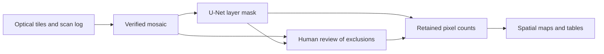

# MosaicAgent-DD

MosaicAgent-DD estimates the spatial distribution of monolayer, bilayer and thicker molybdenum disulfide (MoS₂) from optical microscopy of samples grown by chemical vapour deposition (CVD). It stitches overlapping fields into a mosaic, applies a fixed U-Net and counts pixels inside a reviewed measurement area. Each reported layer fraction can be traced to the source scan, model, included pixels and reviewer exclusions.

The software accompanies the *Digital Discovery* study of CVD-grown MoS₂. Its post-acquisition Orchestrator runs a fixed sequence of tools, checks their outputs, supports bounded retries and sends unresolved cases to a human. Optional vision-language assistance is available for image review. Acquisition, registration, inference and counting each have an inspectable numerical or instrument record. [Architecture](docs/ARCHITECTURE.md) · [中文说明](README_zh.md)

**[Try the software](#quickstart)** · **[Process a scan](#process-an-experimental-scan)** · **[Read a result](#interpret-a-layer-map)** · **[Code and data citation](#cite-the-software-and-data)**



## Quickstart

### Check registration on a clean clone

With Git and Python 3.12, run the following from a terminal on macOS or Linux. Only the base dependencies are needed. The check generates its own microscope-like images, including a simulated serpentine scan with retakes. Once dependencies are installed, it runs offline without images, model weights, a microscope or an API key.

```sh
git clone https://github.com/YongXie-ICMM/MosaicAgent-DD.git
cd MosaicAgent-DD
python3.12 -m venv .venv
source .venv/bin/activate
python -m pip install -r requirements.txt
python register.py
```

On Windows PowerShell, create the environment with `py -3.12 -m venv .venv` and activate it with `.\.venv\Scripts\Activate.ps1`. Look for the final line **`总计: 全部通过`** (“all checks passed”). The checks cover recovered tile shifts, rejection of implausibly thin overlaps, global positions on a known grid, and detection of disconnected tile groups. [Registration self-test](register.py)

### Produce a layer map with a known answer

This example exercises the same spatial exporter used for experimental masks. Run it once from the clone with the environment above active. The eight synthetic pixels include three monolayer, two bilayer, one thicker-layer and two substrate pixels. The entire toy canvas is valid scan area.

```sh
python -m pip install "matplotlib>=3.7,<4"
mkdir synthetic-example
python -c "import numpy as np; np.save('synthetic-example/mask.npy', np.array([[0, 2, 2, 1], [3, 0, 2, 1]], dtype=np.uint8))"
python tools/layer_spatial_maps.py --mask synthetic-example/mask.npy --sample toy --heatmap-grid 2 1 --combined-grid 2 1 --output synthetic-example/maps
```

Open `synthetic-example/maps/spatial_manifest.json` and inspect `global`. Bilayer **composition** is 2/6, or 33.3% of the crystal area. Bilayer **coverage** is 2/8, or 25% of the retained scan area. The adjacent CSV tables and figures come from the same counts. Choose a fresh output directory for each export. [Spatial exporter](tools/layer_spatial_maps.py)

## Process an experimental scan

| Step | Input and operation | What to inspect |
| --- | --- | --- |
| 1. Acquire and verify | The Windows camera and XY stage save overlapping fields with position IDs. Intake binds the original files and acquisition events to one session. | Check image inventory, hashes, retakes and missing positions. The operator handles refocusing. |
| 2. Register and stitch | Register overlapping neighbours, estimate illumination and per-tile colour gains, then blend the mosaic. Verified scan grids preserve row and column identities on low-texture images. | Check the IDs of tiles that actually contributed pixels, the valid support, and any gaps or seams. |
| 3. Infer and review | The fixed 0409 U-Net predicts native layer classes. The guided workbench proposes exclusion boxes and displays the optical image beside its segmentation. | Check capture geometry, edit or accept boxes and explicitly confirm the reviewed area before exporting final guided statistics. |
| 4. Summarize | Count retained pixels per class across the whole map and in each spatial cell. Export PNG/SVG figures, CSV tables, NPZ arrays and a JSON manifest. | Trace each figure to its mask, support and exclusions. Compare full-area and retained-area results when an exclusion affects the interpretation. |

The English/Chinese browser workbench walks an operator through seven steps and keeps earlier review tools at `/review/`. Its project `Memory/` directory binds the scan inventory to prepared jobs, execution logs, output hashes and review records. Start with the job's manifest when investigating a missing tile or a disputed measurement. The five-stage post-acquisition controller runs stitching, segmentation, auditing, region review and statistics. A failed check can invoke a named repair or raise an item for human review. [Workbench and Memory](docs/DD_WORKFLOW.md) · [Controller](flakepipeline/orchestrator.py) · [Spatial review](docs/SPATIAL_REGION_REVIEW.md)

### Environment and assets

| Use | Requirements |
| --- | --- |
| Stitching or the registration self-test | Base Python packages in [requirements.txt](requirements.txt). |
| Full analysis on a separate workstation | Install [requirements-analysis.txt](requirements-analysis.txt) for layer inference, plotting and spectrum processing. The [development profile](requirements-dev.txt) additionally installs the test tools. |
| Current source on the laboratory instrument | Install the [pinned 64-bit Python 3.9.18 profile](requirements-student-py39.txt). It retains NumPy 1.26.2 and OpenCV 4.10.0.84 from instrument runs. Windows x64 acquisition also needs the appropriate vendor drivers and SDKs. |
| Two-image layer demo | From the [v0.1.0 release](https://github.com/YongXie-ICMM/MosaicAgent-DD/releases/tag/v0.1.0), download `MosaicAgent-DD-student-complete.zip`. Copy `data/demo/assets.json`, `data/demo/source_images.zip` (keep zipped) and `weights/model_0409_all.pth` into the same paths under the cloned repository. The Git clone supplies the source and configuration examples. |

If you run the v0.1.0 kit directly, follow that release's Python 3.10+ instructions and numbered launchers. To run the demo from the current source checkout, install the analysis dependencies and copy the three release assets listed above. From the repository root, verify the inputs, run inference and open the workbench.

```sh
python tools/student_demo.py check
python tools/student_demo.py run
python tools/student_demo.py workbench
```

A successful check reports `Verified 2 images and supplied checkpoint; no model loaded.` The demo contains two original 1920 × 1080 fields on 260 nm SiO₂/Si and writes fresh inference outputs. Its manifest records the same-field-of-view confirmation for these two examples. The two fields demonstrate execution. Their adjacency and independent ground-truth layer labels have not been established. [Data and checkpoints](docs/DATA_AND_REPRODUCIBILITY.md) · [Capture scale and model window](docs/RESOLUTION_AND_INFERENCE.md)

### Command-line analysis

**Stitch an acquired scan.** Prepare a profile for the actual image dimensions and verified acquisition geometry. Save `profile.json`, `preflight.json` and `layer_input_contract.json` with the run. Use the offline path with a new work directory.

```sh
python run_stitch.py --data /path/to/scan --work /path/to/new_work \
  --out /path/to/new_mosaic.png --stitch-profile /path/to/profile.json --no-ai
```

Colour correction is enabled by default. Insufficient or inconsistent overlap evidence stops the run. The historical control uses `--colour-correction off` and a separate work directory. Source images remain intact. [Colour-correction evidence](docs/diagnostics/20261031_default_colour_correction.md)

**Analyze a mosaic.** Start with the [offline layer configuration](configs/layer_analysis.example.json). In a local copy, set the sample, mosaic, work directory and trusted checkpoint. Confirm substrate, optical scale and inference geometry before processing a new acquisition. The [guided teacher template](configs/layer_workflow.teacher_template.json) needs these confirmations for the actual sample. The U-Net's 512-pixel input window and the native mosaic scale serve different purposes. [Layer analysis CLI](flakepipeline/README.md) · [Resolution and inference](docs/RESOLUTION_AND_INFERENCE.md)

**Export an existing native mask.** Provide the aligned valid-support mask and any reviewed exclusions. Add `--mosaic` for a Figure 4 view that aligns the optical mosaic, segmentation and local composition.

```sh
python tools/layer_spatial_maps.py --mask /path/to/native_mask.npy \
  --valid-mask /path/to/valid_support.npy --exclusions /path/to/exclusions.npy \
  --sample sample_id --output /path/to/new_spatial_output
```

**Inspect optical spectra.** The separate spectral workflow reads measured files, checks the energy axis and reference information, and supports A/B exciton fitting and substrate-matched calibration. Retain the microscope point image, acquisition footprint, raw sample/reference signals and settings. Stacking assignments need independent supporting evidence. [Spectroscopy guide and numeric QC example](docs/SPECTRA.md)

## Interpret a layer map

| Native integer ID | Class | Exact label PNG colour (RGB) |
| --- | --- | --- |
| 0 | Substrate/background | 0, 0, 0 |
| 1 | Bilayer (2L) | 128, 0, 0 |
| 2 | Monolayer (1L) | 0, 128, 0 |
| 3 | Thicker layers (TL), pooled | 128, 128, 0 |

Use the full-resolution mask, valid scan support and approved exclusions. Retained scan area includes substrate. Retained crystal area includes only 1L + 2L + TL. A cell with zero retained crystal area has undefined composition. Whole-map, row and column fractions use summed pixel counts. A millimetre scale requires an independent spatial calibration. [Counting definitions and file formats](docs/SPATIAL_LAYER_MAPS_zh.md)

To assess sensitivity to a suspected deposit, export the same native mask and valid support twice, first with all supported regions retained and then with the reviewed exclusion. Compare the class counts, retained denominators and before/after fractions. Report the basis for the exclusion alongside the effect on composition. The software records the operator's decision and its quantitative consequences. Physical identification of a deposit requires separate evidence. [Region-review procedure](docs/SPATIAL_REGION_REVIEW.md)

## What the validation establishes

- **Geometry.** Preserving the acquired row/column identities corrected 16 misplaced rows in an 864-image low-texture scan. All 864 images contributed to the final mosaic. [Recorded-grid case](docs/diagnostics/20261009_recorded_grid_stitching.md)
- **Colour consistency.** A 1,000-image replay retained all tile IDs and reduced the fitted overlap log-RMS from 1.480% to 0.770%. This measures overlap consistency in that replay. Layer accuracy under new capture conditions still requires independently labelled examples. [Colour-correction case](docs/diagnostics/20261031_default_colour_correction.md)
- **Acquisition and packaging.** On 31 October 2026 the C1 scanner completed 9- and 1,000-image scans in one application session. The historical 270-file trial kit passed scanner and checkpoint hash checks, and an extracted synthetic spatial job produced 16 verified artifacts. These checks cover normal acquisition, logging and package execution. End-to-end acceptance on the Windows instrument and the cause of the earlier stage SDK fault are tracked separately. [Workflow validation](docs/DD_WORKFLOW.md) · [Incident history](docs/INCIDENT_HISTORY.md) · [Trial kit](docs/DD_TRIAL_KIT_zh.md)
- **Software.** Offline CI exercises Python 3.9.18 and 3.12. Open the workflow run for the commit you intend to use to see its exact checks and results. [GitHub Actions](https://github.com/YongXie-ICMM/MosaicAgent-DD/actions/workflows/offline-tests.yml)

## Optional model supervision

Kimi can assist selected layout, tile, seam, region or spectral reviews. Enabling the external provider can transmit selected images or plots. In the guided spatial review, only paired optical/segmentation ROI previews are submitted, and the reviewer decides which boxes to confirm. Numerical registration, U-Net inference, coverage and pixel counts remain traceable to their local inputs. Use `--no-ai` when running supported command-line tools offline. Guided layer-analysis jobs disable external calls and automatic repair. [Model roles](docs/ARCHITECTURE.md) · [ROI review and decision records](docs/SPATIAL_REGION_REVIEW.md)

## Cite the software and data

Cite **MosaicAgent-DD** with the repository URL and the full commit used for the run. For example, the fixed reviewer source snapshot is [MosaicAgent-DD at `018c5a7`](https://github.com/YongXie-ICMM/MosaicAgent-DD/tree/018c5a7a5b4f8415891f1d3f9ad1c208b1e9d4a5). Use `git rev-parse HEAD` to record your own revision. If you used a packaged distribution, include its version and manifest identifier. The public [v0.1.0 software preview](https://github.com/YongXie-ICMM/MosaicAgent-DD/releases/tag/v0.1.0) predates the reviewer snapshot. The later local key-free trial kit is documented separately. Cite the [companion dataset for Figures 3–7](https://doi.org/10.5281/zenodo.20582052) separately when those research data are used. Its metadata are public and its files have restricted access.

The [provenance record](docs/PROVENANCE.md) identifies upstream code, hardware dependencies and third-party terms. The 16 bundled scanner runtime files are hash-locked to their recorded revision. The separately maintained [AmScope-Camera](https://github.com/YongXie-ICMM/AmScope-Camera) repository carries the communication-logging scanner. The repository gives no additional redistribution rights for vendor SDKs. [Contributor instructions](AGENTS.md)
